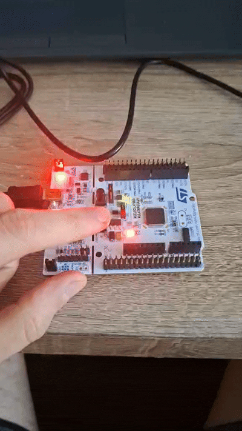

# Sterowanie przekaźnikiem przyciskiem – STM32L476RG (rejestry)

Program dla **NUCLEO-L476RG** napisany wyłącznie na rejestrach (CMSIS).
Przycisk użytkownika steruje przekaźnikiem, a dioda **PA5 (LD2)** wizualizuje jego stan.

## Funkcje

| Akcja                               | Efekt                                                                 |
|-------------------------------------|-----------------------------------------------------------------------|
| Krótkie naciśnięcie (≤ 0,5 s)       | Przełączenie przekaźnika (po zwolnieniu przycisku)                    |
| Długie przytrzymanie (> 0,5 s)      | Przełączenie po 0,5 s, potem cyklicznie co 1 s, dopóki przycisk wciśnięty |
| Debouncing                          | Stan przycisku musi być stabilny przez 20 ms                          |
| Wizualizacja                        | Dioda PA5 odzwierciedla stan przekaźnika (przy długim przytrzymaniu miga co 1 s) |

Po zwolnieniu przycisku w trybie długim przekaźnik zostaje w ostatnim stanie.

## Piny

| Funkcja    | Pin  | Uwagi                                           |
|------------|------|-------------------------------------------------|
| Przycisk   | PC13 | USER button, aktywny stanem niskim (pull-up na płytce) |
| Przekaźnik | PA8  | D7 na złączu Arduino, wyjście push-pull         |
| Dioda      | PA5  | LD2 na płytce                                   |

